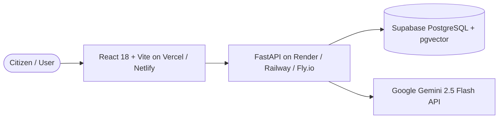

# NitiSetu — Deployment Guide

This guide covers deploying NitiSetu to production across standard cloud providers.

---

## Architecture Overview



---

## 1. Database Setup (Supabase)

1. Create a free project at [supabase.com](https://supabase.com).
2. Go to the **SQL Editor** in your Supabase dashboard.
3. Open [`backend/supabase_schema.sql`](file:///Users/sparsh/Downloads/Forge_ByteBrigade/backend/supabase_schema.sql), copy its entire content, paste it into the SQL Editor, and click **Run**.
   - This creates all required tables (`profiles`, `schemes`, `scheme_rules`, `source_documents`, `document_chunks`, `user_documents`, `application_drafts`).
   - Enables `vector` extension and configures Row Level Security (RLS) policies.
4. Copy your credentials from **Project Settings -> API** & **Project Settings -> Database**:
   - `DATABASE_URL` (Connection URI with Transaction Pooler or Session mode)
   - `SUPABASE_URL`
   - `SUPABASE_ANON_KEY`
   - `SUPABASE_SERVICE_ROLE_KEY`

---

## 2. Deploying Backend (FastAPI on Render / Railway)

### Option A: Render.com (Recommended Free/Easy Option)
1. Push this repository to GitHub.
2. Sign in to [render.com](https://render.com) and click **New + -> Blueprint**.
3. Select your GitHub repository. Render will automatically detect [`render.yaml`](file:///Users/sparsh/Downloads/Forge_ByteBrigade/render.yaml).
4. Fill in the required environment variables:
   - `DATABASE_URL`: Your Supabase connection string
   - `SUPABASE_URL`: Your Supabase URL
   - `SUPABASE_ANON_KEY`: Your Supabase anon key
   - `GEMINI_API_KEY`: Your Google Gemini API Key
   - `FRONTEND_ORIGIN`: `*` (or your Vercel frontend domain)
5. Click **Apply**. Render will build and deploy your API (e.g., `https://nitisetu-api.onrender.com`).

### Option B: Railway.app
1. Go to [railway.app](https://railway.app) and click **New Project -> Deploy from GitHub repo**.
2. Railway detects the [`Dockerfile`](file:///Users/sparsh/Downloads/Forge_ByteBrigade/Dockerfile) or [`Procfile`](file:///Users/sparsh/Downloads/Forge_ByteBrigade/Procfile).
3. In **Variables**, add:
   - `PORT`: `8000`
   - `DATABASE_URL`: `<Your Supabase DB URL>`
   - `SUPABASE_URL`: `<Your Supabase URL>`
   - `SUPABASE_ANON_KEY`: `<Your Supabase Anon Key>`
   - `GEMINI_API_KEY`: `<Your Gemini Key>`
   - `FRONTEND_ORIGIN`: `*`
4. Click **Deploy**. Note down the assigned public domain.

---

## 3. Deploying Frontend (React + Vite on Vercel)

1. Sign in to [vercel.com](https://vercel.com) and click **Add New... -> Project**.
2. Import your GitHub repository.
3. Configure the project:
   - **Framework Preset**: Vite
   - **Root Directory**: `frontend`
4. Under **Environment Variables**, add:
   - `VITE_API_BASE_URL`: `https://<YOUR-BACKEND-DOMAIN>/api/v1` (e.g. `https://nitisetu-api.onrender.com/api/v1`)
5. Click **Deploy**.
   - Vercel will build and deploy the React frontend in under a minute with global CDN edge routing and automatic HTTPS.

---

## 4. Single-Command Docker Deployment (VPS / Self-Hosted)

If you have a Linux VPS (AWS EC2, DigitalOcean Droplet, Hetzner, etc.):

1. Clone your repository:
   ```bash
   git clone <YOUR_REPO_URL>
   cd Forge_ByteBrigade
   ```
2. Populate `backend/.env` with your Supabase and Gemini credentials.
3. Launch with Docker Compose:
   ```bash
   docker-compose up -d --build
   ```
4. Access:
   - Frontend: `http://<YOUR_SERVER_IP>:5173`
   - Backend API: `http://<YOUR_SERVER_IP>:8000`
   - API Docs: `http://<YOUR_SERVER_IP>:8000/docs`

